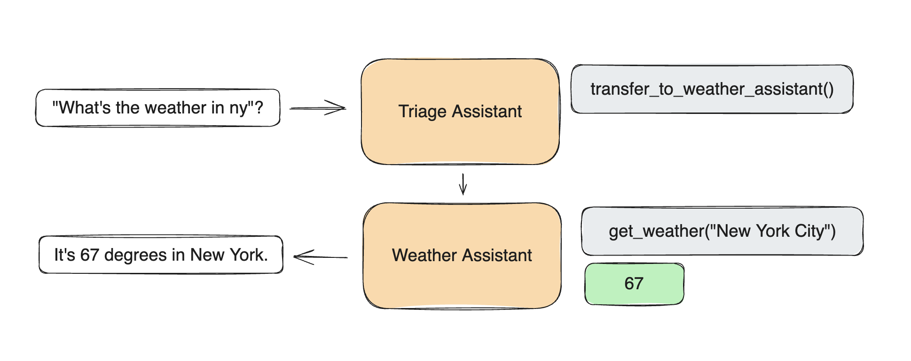

# Swarm（实验性、教学性质）

[English](README.md) | [简体中文](README.zh.md)

> [!IMPORTANT]
> Swarm 目前已被 [OpenAI Agents SDK](https://github.com/openai/openai-agents-python) 取代，后者是 Swarm 面向生产级环境的进化版本。Agents SDK 具备多项关键改进，并将由 OpenAI 团队积极维护。
>
> 我们建议所有生产使用场景均迁移至 Agents SDK。

## 安装

需要 Python 3.10+

```shell
pip install git+ssh://git@github.com/openai/swarm.git
```

或

```shell
pip install git+https://github.com/openai/swarm.git
```

## 使用方法

```python
from swarm import Swarm, Agent

client = Swarm()

def transfer_to_agent_b():
    return agent_b


agent_a = Agent(
    name="Agent A",
    instructions="You are a helpful agent.",
    functions=[transfer_to_agent_b],
)

agent_b = Agent(
    name="Agent B",
    instructions="Only speak in Haikus.",
)

response = client.run(
    agent=agent_a,
    messages=[{"role": "user", "content": "I want to talk to agent B."}],
)

print(response.messages[-1]["content"])
```

```
Hope glimmers brightly,
New paths converge gracefully,
What can I assist?
```

## 目录

- [概述](#概述)
- [示例](#示例)
- [文档](#文档)
  - [运行 Swarm](#运行-swarm)
  - [智能体 (Agents)](#智能体-agents)
  - [函数 (Functions)](#函数-functions)
  - [流式传输 (Streaming)](#流式传输-streaming)
- [评估 (Evaluations)](#评估-evaluations)
- [实用工具 (Utils)](#实用工具-utils)

# 概述

Swarm 专注于使智能体（agent）的**协调（coordination）**与**执行（execution）**变得轻量化、高度可控且易于测试。

它通过两个基础抽象来实现这一目标：`Agent` 与**交接（handoffs）**。一个 `Agent` 包含 `instructions`（指令）与 `tools`（工具），并且可以在任何时刻选择将对话交接给另一个 `Agent`。

这些基础原语具有足够的表达能力，可以展现工具与智能体网络之间丰富的动态交互，使您能够在避免陡峭学习曲线的同时，构建可扩展的现实世界解决方案。

> [!NOTE]
> Swarm Agents 与 Assistants API 中的 Assistants 毫无关联。它们仅仅是为了使用方便而命名相仿，在底层没有任何联系。Swarm 完全由 Chat Completions API 驱动，因此调用之间是完全无状态（stateless）的。

## 为什么选择 Swarm

Swarm 探索了在设计上天生轻量、可扩展且高度可定制的模式。类似 Swarm 的方法最适合用于处理大量独立能力与指令的情况，这些能力和指令往往很难编码进单个 Prompt 中。

对于需要完全托管的线程（threads）以及内置记忆管理与检索功能的开发者而言，Assistants API 是极佳的选择。然而，Swarm 是面向希望了解多智能体编排的开发者的教学资源。Swarm（几乎）完全在客户端运行，与 Chat Completions API 非常相似，在调用之间不存储任何状态。

# 示例

查看 `/examples` 获取灵感！在每个示例的 README 中了解更多信息：

- [`basic`](examples/basic)：基础概念的简单示例，如环境设置、函数调用（function calling）、智能体交接（handoffs）以及上下文变量（context variables）
- [`triage_agent`](examples/triage_agent)：设置基础分流（triage）步骤以交接给合适智能体的简单示例
- [`weather_agent`](examples/weather_agent)：函数调用的简单示例
- [`airline`](examples/airline)：在航空客服场景下处理不同客户服务请求的多智能体设置
- [`support_bot`](examples/support_bot)：包含用户界面智能体和带有多个工具的帮助中心智能体的客户服务机器人
- [`personal_shopper`](examples/personal_shopper)：可以协助销售与订单退款的专属导购智能体

# 文档



## 运行 Swarm

首先实例化一个 Swarm 客户端（其内部实际上就是实例化了一个 `OpenAI` 客户端）。

```python
from swarm import Swarm

client = Swarm()
```

### `client.run()`

Swarm 的 `run()` 函数类似于 Chat Completions API 中的 `chat.completions.create()` 函数——它接收 `messages` 并返回 `messages`，且在调用之间不保存任何状态。但关键在于，它还负责处理智能体函数执行、交接（handoffs）、上下文变量引用，并且在返回给用户之前可以进行多轮交互。

在底层核心，Swarm 的 `client.run()` 实现了以下循环：

1. 从当前智能体获取补全（completion）
2. 执行工具调用（tool calls）并追加执行结果
3. 必要时切换智能体（Agent）
4. 必要时更新上下文变量（context variables）
5. 如果没有新的函数调用，则返回结果

#### 参数说明

| 参数 | 类型 | 说明 | 默认值 |
| :--- | :--- | :--- | :--- |
| **agent** | `Agent` | 被调用的（初始）智能体。 | (必填) |
| **messages** | `List` | 消息对象列表，与 [Chat Completions `messages`](https://platform.openai.com/docs/api-reference/chat/create#chat-create-messages) 完全一致 | (必填) |
| **context_variables** | `dict` | 额外上下文变量的字典，可供函数及智能体指令访问 | `{}` |
| **max_turns** | `int` | 允许的最大对话轮数 | `float("inf")` |
| **model_override** | `str` | 可选字符串，用于覆盖智能体所使用的模型 | `None` |
| **execute_tools** | `bool` | 若为 `False`，当智能体尝试调用函数时立即中断执行并返回 `tool_calls` 消息 | `True` |
| **stream** | `bool` | 若为 `True`，启用流式响应 | `False` |
| **debug** | `bool` | 若为 `True`，启用调试日志 | `False` |

`client.run()` 执行完毕后（可能经过对智能体和工具的多次调用），它将返回一个包含所有相关更新状态的 `Response` 对象。具体包括：新的 `messages`、最后被调用的 `Agent` 以及最新的 `context_variables`。您可以将这些值（加上新的用户消息）传入下一次 `client.run()` 调用中，以便在上次中断的地方继续交互——非常类似于 `chat.completions.create()`。（`/swarm/repl/repl.py` 中的 `run_demo_loop` 函数实现了一个完整执行循环的示例。）

#### `Response` 字段说明

| 字段 | 类型 | 说明 |
| :--- | :--- | :--- |
| **messages** | `List` | 对话期间生成的历史消息对象列表。非常类似于 [Chat Completions `messages`](https://platform.openai.com/docs/api-reference/chat/create#chat-create-messages)，但带有一个 `sender` 字段，用于指示该消息来自于哪个 `Agent`。 |
| **agent** | `Agent` | 处理最后一条消息的智能体。 |
| **context_variables** | `dict` | 与输入的变量相同，加上所有的修改变更。 |

## 智能体 (Agents)

一个 `Agent` 仅仅封装了一组 `instructions`（指令）与一组 `functions`（函数）（外加以下的一些额外设置），并具备将执行权交接给另一个 `Agent` 的能力。

虽然人们容易将 `Agent` 拟人化为“负责做某事的某个人”，但它同样可以用来代表由一组 `instructions` 和 `functions` 定义的特定工作流或步骤（例如一系列流程步骤、复杂的检索、单步数据转换等）。这使得 `Agent` 可以组合成由“智能体”、“工作流”与“任务”构成的网络，且全部由同一个原语表达。

## `Agent` 字段说明

| 字段 | 类型 | 说明 | 默认值 |
| :--- | :--- | :--- | :--- |
| **name** | `str` | 智能体的名称。 | `"Agent"` |
| **model** | `str` | 智能体所使用的模型。 | `"gpt-4o"` |
| **instructions** | `str` 或 `func() -> str` | 智能体的指令，可以是字符串或返回字符串的可调用对象。 | `"You are a helpful agent."` |
| **functions** | `List` | 智能体可以调用的函数列表。 | `[]` |
| **tool_choice** | `str` | 智能体的工具选择策略（如有）。 | `None` |

### 指令 (Instructions)

`Agent` 的 `instructions` 会直接转换为对话的 `system` 提示词（作为第一条消息）。在任何给定的时刻，仅有当前处于活动状态的 `Agent` 的 `instructions` 会生效（例如，如果发生了智能体交接，`system` 提示词会随之变更，但对话历史记录保持不变。）

```python
agent = Agent(
   instructions="You are a helpful agent."
)
```

`instructions` 既可以是普通的 `str`，也可以是返回 `str` 的函数。该函数可以选择性地接收一个 `context_variables` 参数，该参数将由传入 `client.run()` 的 `context_variables` 填充。

```python
def instructions(context_variables):
   user_name = context_variables["user_name"]
   return f"Help the user, {user_name}, do whatever they want."

agent = Agent(
   instructions=instructions
)
response = client.run(
   agent=agent,
   messages=[{"role":"user", "content": "Hi!"}],
   context_variables={"user_name":"John"}
)
print(response.messages[-1]["content"])
```

```
Hi John, how can I assist you today?
```

## 函数 (Functions)

- Swarm 的 `Agent` 可以直接调用 Python 函数。
- 函数通常应该返回一个 `str`（系统会尝试将返回值转换为 `str`）。
- 如果函数返回了一个 `Agent`，执行流程将转移交接给该 `Agent`。
- 如果函数定义了 `context_variables` 参数，该参数将由传入 `client.run()` 的 `context_variables` 自动填充。

```python
def greet(context_variables, language):
   user_name = context_variables["user_name"]
   greeting = "Hola" if language.lower() == "spanish" else "Hello"
   print(f"{greeting}, {user_name}!")
   return "Done"

agent = Agent(
   functions=[greet]
)

client.run(
   agent=agent,
   messages=[{"role": "user", "content": "Usa greet() por favor."}],
   context_variables={"user_name": "John"}
)
```

```
Hola, John!
```

- 如果 `Agent` 的函数调用发生错误（缺少函数、参数错误或执行异常），错误响应会被追加到对话中，以便 `Agent` 能够优雅地自我纠错与恢复。
- 如果 `Agent` 调用了多个函数，它们将按照调用顺序依次执行。

### 智能体交接与上下文变量更新 (Handoffs and Updating Context Variables)

`Agent` 可以通过在 `function` 中返回另一个 `Agent` 来进行交接。

```python
sales_agent = Agent(name="Sales Agent")

def transfer_to_sales():
   return sales_agent

agent = Agent(functions=[transfer_to_sales])

response = client.run(agent, [{"role":"user", "content":"Transfer me to sales."}])
print(response.agent.name)
```

```
Sales Agent
```

它还可以通过返回更完整的 `Result` 对象来更新 `context_variables`。`Result` 对象还可以包含一个 `value` 以及一个 `agent`，适用于希望单个函数同时返回值、更新目标智能体并更新上下文变量（或三者的任意子集）的场景。

```python
sales_agent = Agent(name="Sales Agent")

def talk_to_sales():
   print("Hello, World!")
   return Result(
       value="Done",
       agent=sales_agent,
       context_variables={"department": "sales"}
   )

agent = Agent(functions=[talk_to_sales])

response = client.run(
   agent=agent,
   messages=[{"role": "user", "content": "Transfer me to sales"}],
   context_variables={"user_name": "John"}
)
print(response.agent.name)
print(response.context_variables)
```

```
Sales Agent
{'department': 'sales', 'user_name': 'John'}
```

> [!NOTE]
> 如果一个 `Agent` 调用了多个用于交接至其他 `Agent` 的函数，则仅会采用最后一个交接函数。

### 函数模式 (Function Schemas)

Swarm 会自动将函数转换为传递给 Chat Completions `tools` 的 JSON Schema。

- Docstrings（文档字符串）会被转换为函数的 `description`。
- 没有默认值的参数会被标记为 `required`。
- 类型提示（Type hints）会被映射到参数的 `type`（默认映射为 `string`）。
- 虽不显式支持针对每个参数的专门描述字段，但如果直接写在 docstring 中，模型也能同样理解。（未来可能会添加针对 docstring 参数的解析支持。）

```python
def greet(name, age: int, location: str = "New York"):
   """Greets the user. Make sure to get their name and age before calling.

   Args:
      name: Name of the user.
      age: Age of the user.
      location: Best place on earth.
   """
   print(f"Hello {name}, glad you are {age} in {location}!")
```

```javascript
{
   "type": "function",
   "function": {
      "name": "greet",
      "description": "Greets the user. Make sure to get their name and age before calling.\n\nArgs:\n   name: Name of the user.\n   age: Age of the user.\n   location: Best place on earth.",
      "parameters": {
         "type": "object",
         "properties": {
            "name": {"type": "string"},
            "age": {"type": "integer"},
            "location": {"type": "string"}
         },
         "required": ["name", "age"]
      }
   }
}
```

## 流式传输 (Streaming)

```python
stream = client.run(agent, messages, stream=True)
for chunk in stream:
   print(chunk)
```

使用与 [Chat Completions API 流式传输](https://platform.openai.com/docs/api-reference/streaming) 相同的事件。可参考 `/swarm/repl/repl.py` 中的 `process_and_print_streaming_response` 作为示例。

新增了两种事件类型：

- `{"delim":"start"}` 与 `{"delim":"end"}`：用于在 `Agent` 每次处理单条消息（响应或函数调用）时发出信号，有助于识别 `Agent` 之间的切换过程。
- `{"response": Response}`：在流的末尾返回一个包含聚合（完整）响应的 `Response` 对象，以方便调用。

# 评估 (Evaluations)

评估对于任何项目都至关重要，我们鼓励开发者引入自己的评估套件来测试 swarm 的性能表现。作为参考，我们在 `airline`、`weather_agent` 以及 `triage_agent` 快速开始示例中提供了如何评估 swarm 的示例。详情请参阅各自的 README。

# 实用工具 (Utils)

使用 `run_demo_loop` 来测试您的 swarm！这将在命令行中运行一个交互式 REPL，并支持流式传输。

```python
from swarm.repl import run_demo_loop
...
run_demo_loop(agent, stream=True)
```

# 核心贡献者 (Core Contributors)

- Ilan Bigio - [ibigio](https://github.com/ibigio)
- James Hills - [jhills20](https://github.com/jhills20)
- Shyamal Anadkat - [shyamal-anadkat](https://github.com/shyamal-anadkat)
- Charu Jaiswal - [charuj](https://github.com/charuj)
- Colin Jarvis - [colin-openai](https://github.com/colin-openai)
- Katia Gil Guzman - [katia-openai](https://github.com/katia-openai)

---

> **免责声明**：本文档由社区志愿者进行本地化翻译，旨在促进跨语言的技术交流与学习。如翻译内容与[英文原版](README.md)存在出入，请以英文原版为准。
